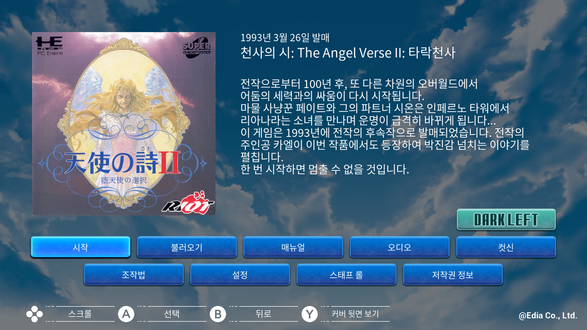

# 천사의 시 2: The Fallen Angel — Nintendo Switch

Nintendo Switch **천사의 시 2: The Fallen Angel** 한글 번역 패치 프로젝트입니다. 마을과 필드를 탐험하며 이야기를 진행하는 판타지 RPG 시리즈 두 번째 작품의 Switch판입니다.

> **최종 배포 v1.5 Final**

<!-- game-preview:start -->

  

**게임 소개·한글 메뉴** — 사용자가 Citron에서 촬영한 Switch판 게임 소개·한글 메뉴 화면입니다. 설치 패치와 공개 배포본의 파일별 일치는 대조하지 않았습니다.
<!-- game-preview:end -->

## 다운로드 및 적용 방법

1. 보유한 Switch판 게임의 Title ID가 `010047B021296000`인지 확인합니다.
2. [최종 배포 패치 다운로드](https://github.com/akuma815/switch-tenshi-no-uta-2-kr-patch/releases/tag/v1.5)에서 압축 파일을 받아 모두 해제합니다.
3. 모드 폴더의 `romfs/Emulator_Tenshinouta/Content/Paks/` 안에 패치 파일 4개를 함께 복사합니다.
4. Atmosphere는 `atmosphere/contents/010047B021296000/romfs/Emulator_Tenshinouta/Content/Paks/` 경로를 사용합니다. 게임을 완전히 종료한 뒤 다시 실행합니다.

## 주의사항

- Switch Title ID 010047B021296000 전용이며 PC Engine판과 호환되지 않습니다.
- 기존 V1.5 Final.7z의 모드 파일 4개를 변경 없이 배포합니다.
- 원본 컨테이너를 교체하지 말고 동일 버전의 패치 파일을 함께 설치하세요.
- 원본 게임·BIOS 및 패치가 적용된 게임 이미지는 포함하지 않습니다.

## 체크섬

| 구분 | SHA-256 |
| --- | --- |
| 모드 패치 `TenshiKR2_P.pak` | `7c3ff25befc093346b4cd80e7af9a5dd8ec008be6e52652d7dc2dd961284340b` |
| 모드 패치 `TenshiKR2_P.ucas` | `556885e731cb78c34e2315802808f2fb576fa1ff5a697d5ade6d06b4d4d1ea87` |
| 모드 패치 `TenshiKR2_P.utoc` | `7516087958c47e9bf96303bc879ff9722e5415c2e477ae85082bf7607f156bc1` |
| 모드 패치 `TenshiKR_Font_P.pak` | `b3bf493377c1b0d950e6c0fc0d5fc1b43b556fc6da172e2ce4ea3b3bec9acc96` |
| 배포 압축 파일 | `044276f82d07e3707b8c3b633ee6304efa4f3093604eef2fae6061d9c6cce6b3` |

지원 원본의 세트·리비전 및 해시는 [상세 패치 안내](docs/PATCH_GUIDE.txt)를 확인하세요.

## 소스 및 작업 기록

[공개 소스 구성과 빌드 전제](docs/SOURCE_GUIDE.md) · [상세 패치 안내](docs/PATCH_GUIDE.txt)

[2026-10-16 최종 빌드 재현·폴더 삭제 검토](docs/REBUILD_2026-10-16.md)
